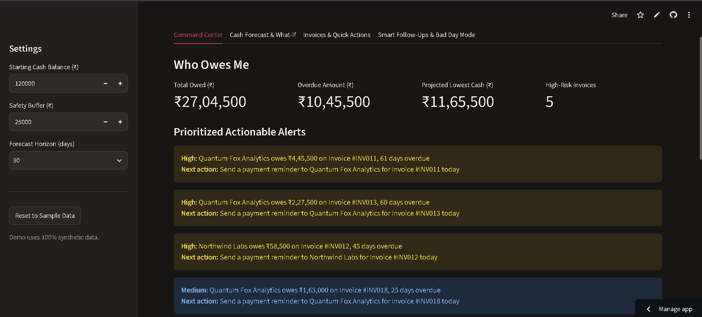
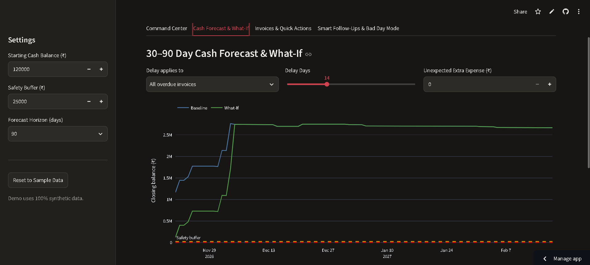
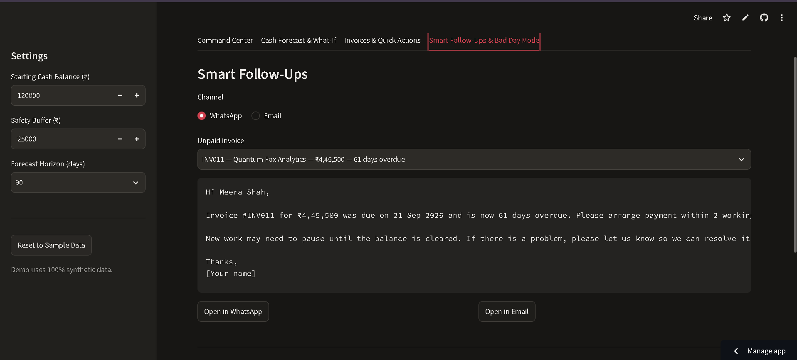

# DevCash

**The One-Person Back Office for Freelance Developers**

DevCash tells a solo freelance developer when cash will run short and which overdue client payments to chase first. It combines receivables tracking, a scikit-learn late-payment risk score, and a 30–90 day cash forecast in one Streamlit dashboard, with ready-to-send INR payment reminders.

**Live Demo:** [https://devcash-backoffice.streamlit.app](https://devcash-backoffice.streamlit.app)

Note: If the Streamlit Community Cloud app is sleeping, click "Yes, get this app back up!" and wait ~20 seconds.

**Screenshots**





## Problem & Target User

**Persona:** Solo freelance developers in India who bill in INR (₹), manage 5–15 clients, and have no accounting or admin staff.

**Core pain:** Businesses rarely fail for lack of clients. They fail because client payments arrive late while fixed bills (rent, internet, cloud and AI tools, tax reserves) arrive on time. Notebooks and WhatsApp chats cannot predict a cash crunch.

## Key Features & ML Architecture

DevCash is a single Streamlit app (`app.py`) with four tabs, backed by modular Python files.

| Tab | Problem it solves | Capabilities |
|---|---|---|
| Command Center ("Who Owes Me") | Which money is owed, and what to do first | KPI cards (Total Owed, Overdue Amount, Projected Lowest Cash, High-Risk Invoices); prioritized actionable alerts; late-payment risk table; one-click Overdue & Risk CSV export |
| Cash Forecast & What-If | Will cash dip below safety levels, and what if a client pays late | Interactive Plotly chart of Baseline vs. What-If balances; 30, 60 or 90 day horizon; collapsible Upcoming Fixed Bills table |
| Invoices & Quick Actions | Keep the receivables ledger current | 4-field invoice creation; one-click Mark as Paid; CSV export of all invoices |
| Smart Follow-Ups & Bad Day Mode | Chase payments without drafting from scratch | Auto-drafted polite, firm or urgent INR reminders; Open in WhatsApp and Open in Email buttons; batch Bad Day Mode for several overdue clients |

**Late-Payment Risk model (`ml_risk.py`)**
- A scikit-learn Pipeline of `StandardScaler` and `LogisticRegression(max_iter=1000)`, trained on invoices with status "Paid" and a `paid_date`.
- An invoice is labelled late only if paid more than `GRACE_DAYS` = 5 days after its due date (the freelance grace period).
- Features: `avg_days_late`, `amount_inr`, `payment_term_days` (due date minus issue date).
- Risk tiers: Low below 40% late probability; Medium from 40% to below 70%; High at 70% or above. Any invoice more than 30 days overdue is raised to High.
- Each invoice gets a plain-English reason, drawn from: "Client averages N days late" (average of 7 or more), "high invoice value" (2× the median invoice amount), "N days overdue", or "Typical client and invoice profile".
- Calibration: none. The code applies no calibration step (such as Platt scaling or isotonic regression); scores are the raw model probabilities.
- Fallback: with fewer than `MIN_TRAINING_ROWS` = 2 Paid invoices, or only one label class, a constant probability is used (the observed late rate, or 0.5), and the UI says so.
- Limitations: the sample has only 13 Paid invoices, so the model is unstable and should be read as a rough indicator. `avg_days_late` is both a feature and the source of the label, so the model partly re-learns each client's past lateness.

**Cash forecast and alerts (`forecast.py`)**
- Unpaid invoices are received on their due date (or today if already overdue). Bills due in the horizon are outflows.
- Settings: Starting Cash Balance (default ₹1,20,000), Safety Buffer (default ₹25,000), Forecast Horizon (30, 60 or 90 days, default 90).
- What-If controls: Delay applies to `ALL_OVERDUE` (default), `HIGH_RISK`, or a single client; Delay Days 0–45 (default 14); Unexpected Extra Expense.
- The chart marks the first dip below the Safety Buffer for both Baseline and What-If, with a dashed ₹0 line.
- Alerts: Critical when the projected balance goes below ₹0, High when it falls below the buffer, plus one alert per overdue invoice (High above 30 days overdue, otherwise Medium).

**Reminders (`reminders.py`)**
- Tone is chosen from days overdue: polite (1–7 days), firm (8–30 days), urgent (more than 30 days). Pre-due reminders are always polite.
- Bad Day Mode drafts one combined message per client, oldest overdue first, with summary metrics.
- Messages are drafted for the user to send. Nothing is sent automatically.

**Data model (CSV files in `data/`)**

| File | Columns |
|---|---|
| `clients.csv` | client_id, client_name, contact_name, contact_email, client_type, avg_days_late |
| `invoices.csv` | invoice_id, client_id, description, amount_inr, issue_date, due_date, status, paid_date |
| `bills.csv` | bill_id, category, vendor, amount_inr, frequency, due_date, auto_pay |

**Project Structure**

```
devcash-backoffice/
├── app.py              Streamlit UI: four tabs, wires the modules together
├── data_manager.py     CSV load/save, add and mark invoices, receivables, INR formatting
├── ml_risk.py          Late-payment model (StandardScaler + LogisticRegression) and risk tiers
├── forecast.py         30/60/90-day cash forecast, what-if delays, actionable alerts
├── reminders.py        Polite / firm / urgent reminder drafting, Bad Day batch
├── seed_data.py        Generates synthetic clients, invoices and bills into data/
├── data/
│   ├── clients.csv
│   ├── invoices.csv
│   └── bills.csv
├── requirements.txt
├── LICENSE
├── README.md
└── .gitignore
```

## Business Viability & Monetization

**Proposed pricing model** (not yet implemented; the current build has no tier gating and all features are available):

| | Free Tier | Pro Tier (proposed) |
|---|---|---|
| Price | ₹0 | ₹299 / month |
| Invoices | Up to 5 active invoices per month | Unlimited |
| Dashboard | Basic dashboard | Full dashboard |
| ML late-payment risk scoring | No | Yes |
| 90-day What-If forecasting | No | Yes |
| Bad Day Mode | No | Yes |
| CSV exports | No | Yes |

**ROI hook:** Recovering one delayed ₹10,000 invoice, or avoiding one rent shortfall, pays for nearly 3 years of DevCash Pro (₹10,000 ÷ ₹299 ≈ 33 months).

**v2 roadmap (not yet implemented):**
- UPI payment links in reminders
- Automated WhatsApp Business API follow-ups
- GST-ready invoice exports

## Built with Codebenders

DevCash was built in the Codebenders IDE with Nexen AI assistance. The AI helped scaffold the modular backend (data, risk, forecast and reminder modules), build the scikit-learn late-payment risk model, implement the Plotly cash-forecast chart, and refine the Streamlit UI iteratively.

## Local Setup, Responsible AI & Credits

**Setup (Windows, PowerShell or cmd):**

```
python -m venv .venv
.venv\Scripts\activate
pip install -r requirements.txt
python seed_data.py
streamlit run app.py
```

`seed_data.py` regenerates the synthetic CSV files in `data/`. The sidebar's "Reset to Sample Data" button runs the same generator.

**Responsible AI & Data Disclaimer:** All data in DevCash is 100% synthetic sample data. No real client, financial, or personal records are collected or stored. Client names, contacts, emails (example.com / example.in), vendors and amounts are fictional.

**License & Third-Party Components**

DevCash is released under the MIT License (see `LICENSE`).

| Component | Version | Role | License |
|---|---|---|---|
| streamlit | Unpinned in requirements.txt | Web UI | Apache-2.0 |
| pandas | Unpinned in requirements.txt | Data handling | BSD-3-Clause |
| numpy | Unpinned in requirements.txt | Numerical operations | BSD-3-Clause |
| plotly | Unpinned in requirements.txt | Forecast charts | MIT |
| scikit-learn | Unpinned in requirements.txt | Late-payment risk model | BSD-3-Clause |
